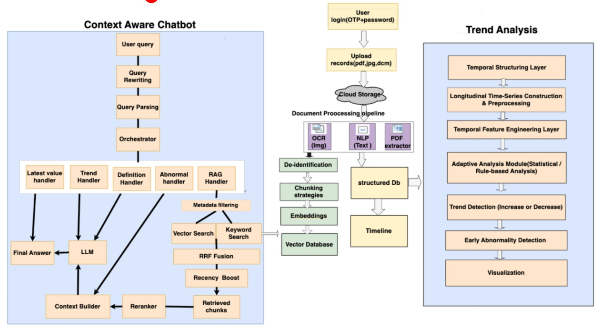
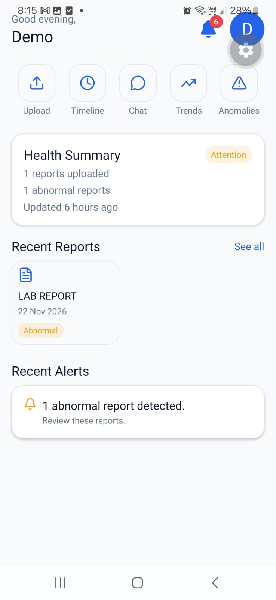
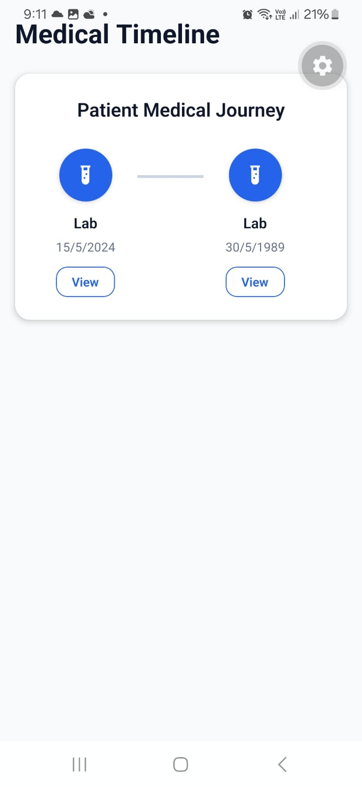
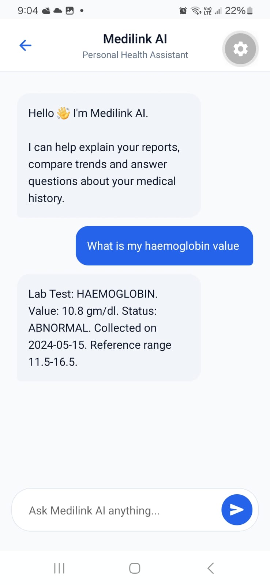
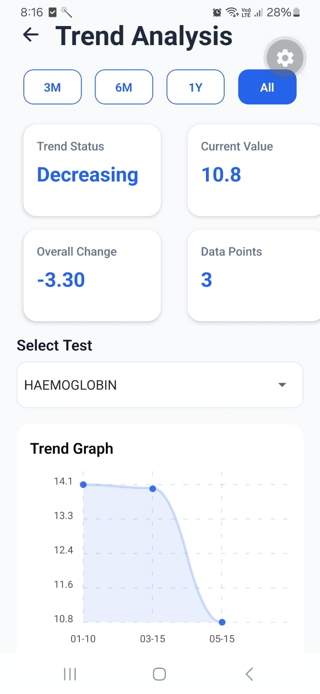
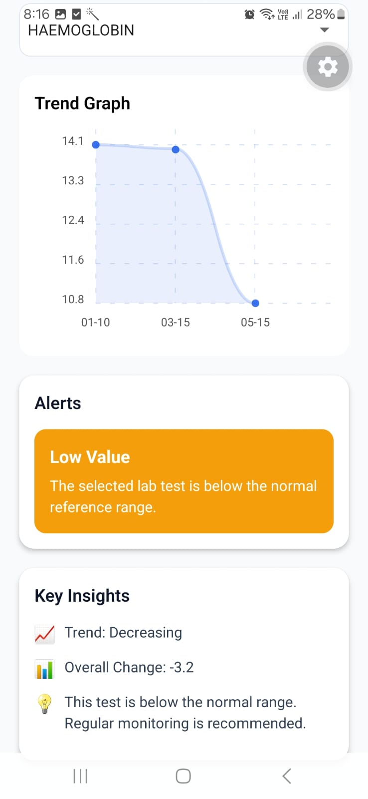
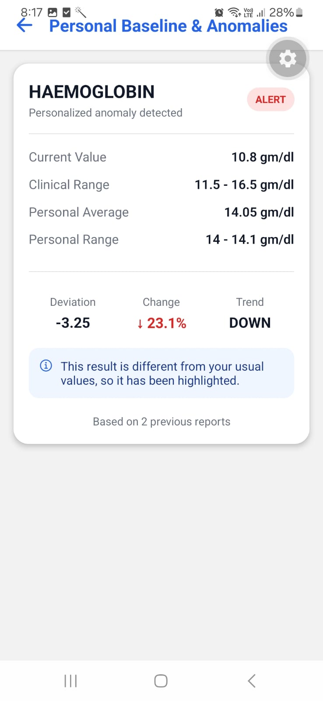
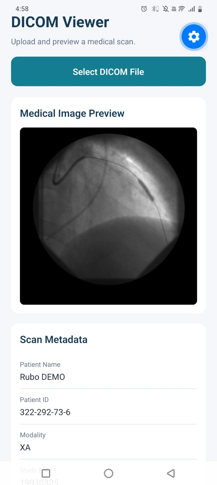
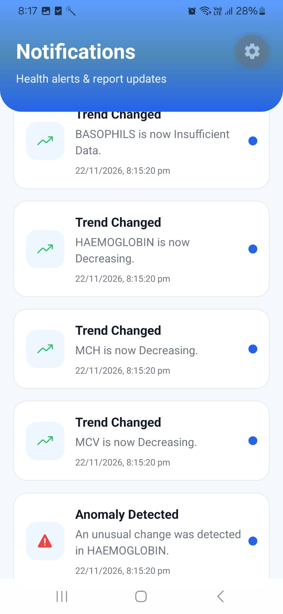

MediLink – Unified Health Record System

A Patient-Centric Platform for Medical Record Management, Personalized Health Monitoring, and AI-Powered Healthcare Assistance.

MediLink is a unified health record management system designed to digitize, centralize, and organize patient medical records. It transforms unstructured medical documents into structured health information, enabling patients to track their medical history, monitor laboratory trends, and interact with an AI-powered chatbot to understand their health records.

The platform integrates medical document processing, longitudinal health trend analysis, personalized anomaly detection, and Retrieval-Augmented Generation (RAG) to provide a centralized and context-aware healthcare information system.

Overview

Medical records are often distributed across multiple hospitals, diagnostic centers, and healthcare providers. Managing these records manually makes it difficult to maintain a complete medical history and identify changes in health measurements over time.

MediLink addresses this problem by providing a centralized platform that:

Digitizes and organizes medical records.

Extracts relevant clinical information from uploaded documents.

Maintains a chronological medical timeline.

Analyzes historical laboratory measurements.

Identifies deviations from personalized health baselines.

Provides an AI-powered chatbot for querying personal medical records.

The system supports patient and doctor access with patient-specific data management.

Key Features

1. Medical Document Upload and Processing

Supports PDF, image, text, and DICOM medical documents.

Extracts information using PDF parsing and OCR.

Identifies relevant clinical information, including laboratory measurements and medical entities.

Converts extracted information into structured medical records.

Stores original documents separately from structured data.

2. Medical Timeline

Organizes medical records chronologically.

Displays uploaded reports and medical events.

Provides access to historical medical information.

Supports comparison of previous and recent laboratory results.

3. Longitudinal Health Trend Analysis

Analyzes laboratory measurements across multiple time points.

Identifies increasing, decreasing, and stable trends.

Calculates changes using delta, percentage change, moving averages, and linear regression.

Visualizes historical laboratory measurements.

4. Personalized Baseline and Anomaly Detection

Establishes patient-specific baselines using historical laboratory values.

Compares new measurements against personal historical averages.

Identifies significant deviations from individual baselines.

Generates alerts for significant abnormalities.

5. AI-Powered Medical Chatbot

MediLink integrates a Retrieval-Augmented Generation (RAG) pipeline to enable natural-language interaction with personal medical records.

The chatbot supports:

Natural-language queries about uploaded medical records.

Query rewriting using conversation history.

Intent classification and query routing.

Retrieval of relevant patient-specific information.

Context-aware response generation.

6. Hybrid Retrieval and Reranking

Combines semantic vector search with keyword-based retrieval.

Uses Reciprocal Rank Fusion (RRF) to combine retrieval results.

Applies Cross-Encoder reranking to improve retrieval relevance.

Constructs context using relevant medical records and metadata.

7. Authentication and Patient-Specific Access

User registration and login.

JWT-based authentication.

Patient-specific record management.

Controlled access to medical information.

Forgot-password functionality with OTP verification.
Getting Started

Follow these instructions to set up and run MediLink locally.

Prerequisites

Ensure the following tools are installed:

Node.js and npm

Python

Docker Desktop

Docker Compose

Ollama

Git

1. Clone the Repository

git clone https://github.com/moulyajs/Medilink.git

cd Medilink

2. Configure Environment Variables

Configure the environment variables required by the backend services.

Ensure the MinIO credentials are configured in the appropriate environment file:

MINIO_ROOT_USER=your_minio_username
MINIO_ROOT_PASSWORD=your_minio_password

Also configure the database, storage, authentication, and other backend settings according to the backend configuration.

Important: Do not commit .env files, database passwords, API keys, or other sensitive credentials to GitHub.

3. Start Backend Services

Open a terminal at the project root and navigate to the Docker configuration directory:

cd backend/docker

Start the required backend services:

docker compose up -d

This starts the configured supporting services, including:

Qdrant – Vector database.

MinIO – Object storage.

Docling – Document processing service.

Backend – If configured in the Compose services.

Check the running containers:

docker compose ps

4. Start the Backend API

Open another terminal at the project root.

Navigate to the Docker configuration directory:

cd backend/docker

Enter the running backend container:

docker compose exec backend bash

Inside the container, start the FastAPI application:

python -m uvicorn main:app --host 0.0.0.0 --port 8000 --reload

The backend API will be available at:

http://localhost:8000

FastAPI interactive API documentation:

http://localhost:8000/docs

5. Start Ollama

Open another terminal and start the Ollama service:

ollama serve

Ensure that the Mistral model configured for the chatbot is available in Ollama.

The backend must also be configured to access the Ollama service using an address reachable from its runtime environment.

6. Start the Frontend

Open another terminal at the project root:

cd frontend

Start the Expo development server:

npx expo start -c

The Expo development server will start and display the available options for running the application.

Use the Expo development environment to launch the application on a supported device or emulator.

Note: If testing on a physical device, ensure that the frontend API configuration points to an IP address accessible from that device rather than localhost.
System Architecture

MediLink follows a modular, layered architecture consisting of three major components:

Medical Document Processing

Longitudinal Health Trend Analysis

Context-Aware Chatbot

The frontend communicates with backend services through REST APIs.

  

Architecture Overview

Medical Document Processing

PDF and image-based medical documents are processed using PDF parsing and OCR techniques. Extracted information undergoes clinical information extraction, cleaning, and normalization before being converted into structured patient records.

Longitudinal Health Trend Analysis

Historical laboratory measurements are retrieved to calculate personal baselines, identify deviations, and detect increasing, decreasing, or stable trends.

Context-Aware Chatbot

User queries are processed through query rewriting and intent classification. Hybrid retrieval, Reciprocal Rank Fusion, and Cross-Encoder reranking are used to retrieve relevant patient information before generating contextual responses.

Application Screenshots

The following screenshots demonstrate the major functionalities of MediLink.

1. Dashboard

The dashboard provides an overview of the patient's health information and important medical insights.

  

2. Medical Timeline

Displays medical records and health events in chronological order, helping patients understand their medical history.

  

3. AI-Powered Medical Chatbot

Enables patients to ask natural-language questions about their uploaded medical records using Retrieval-Augmented Generation.

  

4. Personalized Health Trend Analysis

Analyzes historical laboratory measurements and visualizes changes over time.

  

  

5. Anomaly Detection

Identifies significant deviations from patient-specific historical laboratory baselines.

  

6. DICOM Support

Supports the processing and handling of DICOM medical imaging files.

  

7. Notifications

Provides notifications related to medical record uploads and significant health changes.

  

